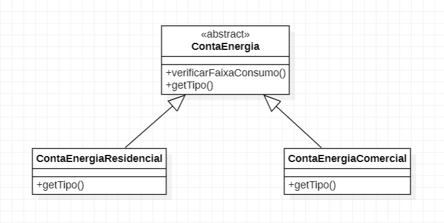

# Exercício Template Method, Conta de Energia
#### Nome: João Vitor Fernandes Ribeiro Carneiro Ramos
#### Matrícula: 202165076C

Implementação do padrão de projeto **Template Method** em Java.

## Diagrama UML

